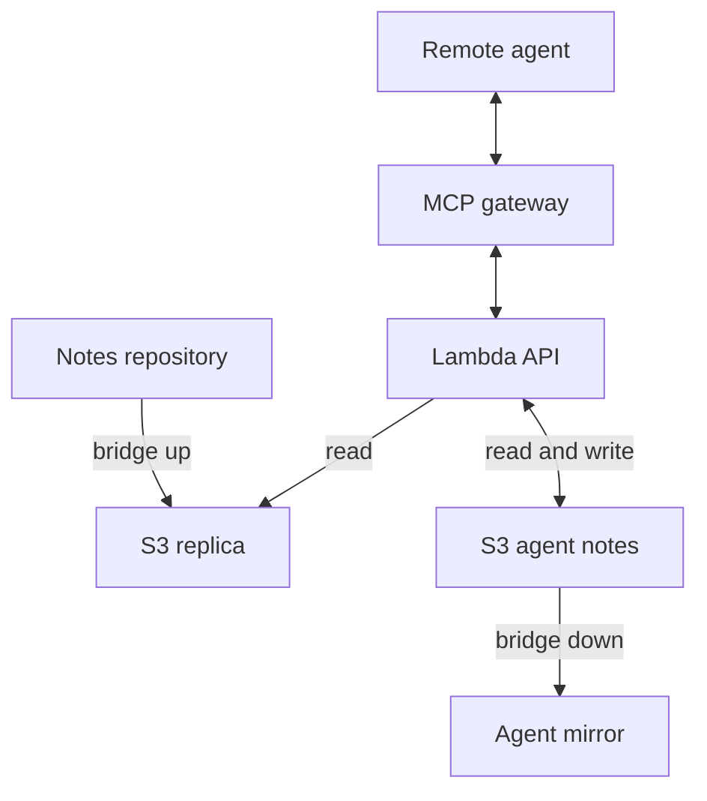

A few months ago, I wrote about [self-hosting mem9 on AWS][previous-post] so the agents I use could share memory. I have now replaced that workflow with [agent-memory-kit][kit], a new project I have released under the [MIT license][license].

The workstation side keeps memory as Markdown notes in a private Git repository. Each machine has a clone. Claude Code, Codex, and Kiro work with those files; agents outside the workstations can use an optional [Memory API][kit-api] through an MCP gateway.

The reason for the change is practical: **I want the next session to find the decisions, preferences, and lessons we already established—and I want to be able to open a file and check what the agent remembers.**

This post covers the move from mem9, the research that informed the design, the AWS implementation, and a monthly cost model. Implementation details refer to the [November 17, 2026 source revision][source-version].

## The research behind the design

Anthropic's November 6 article, [The components of agent memory][anthropic-memory], gave me a useful framework: agents can capture information during a session, then use background work—called *dreaming*—to correct and reorganize it for future sessions.

Three ideas stood out. First, useful memory includes learned strategies and verified rules that would otherwise disappear; copying readily available state can create maintenance work. Second, a small entry point can direct the agent to deeper notes instead of loading everything at startup. Third, background consolidation can repair omissions and contradictions across sessions, but it consumes compute and can introduce mistakes of its own.

That informed my division between ordinary note writing, a short index, and scheduled extraction and organization. It is an adaptation of those ideas to my workflow, not a reproduction of Anthropic's experiments. Their benchmark results do not establish the quality of this kit; its retrieval and memory quality still need evaluation on the tasks it serves.

## Why move away from my mem9 setup?

The earlier deployment solved a problem I still care about: keeping control of shared agent memory. It put the memory service, database, embedding service, and access layer on infrastructure I controlled.

What I increasingly wanted to maintain, however, was a set of engineering notes: why an integration uses a particular path, what the user has explicitly corrected, or where to start investigating a recurring environment failure. These facts need to remain understandable, editable, and traceable.

Files make those operations straightforward. I can edit a note, inspect the diff, and find the commit that introduced a bad assumption. Another agent can read the same directory without adopting a particular memory-service API.

This comparison describes **my previous deployment and this replacement workflow**, rather than every way to run mem9:

| Concern | My previous mem9 deployment | agent-memory-kit |
|---|---|---|
| Primary representation | Records in a memory service | Markdown notes in a private Git repository |
| Recall | Queries to the memory service | Indexes and files locally; keyword search through the optional API |
| Capture | Agent tools and session-ingest hooks | Agents write notes; optional jobs extract facts from transcripts |
| Sharing | Clients contact the same service | Workstations synchronize independent clones |
| Maintenance | Service and database operation | Git synchronization and note quality, plus an API if needed |

I have not benchmarked the two for recall or latency, and I am not claiming a measured percentage saving. I chose a representation I can inspect and a local access path that fits my work, accepting that keyword search will miss some semantically related wording.

## A note needs an entry point

The workstation layout is deliberately small:

```text
~/agent-memory/
├── global/
│   ├── MEMORY.md
│   └── reply-language.md
└── projects/
    └── demo-app/
        ├── .project
        ├── MEMORY.md
        └── integration-test-mail.md
```

`global/` holds facts that apply across projects. Each project folder holds its own decisions and lessons. A `MEMORY.md` index provides a short description and a link to each note; the [note parser][notes-source] handles the metadata and references.

Here is an illustrative note, not a requirement from an actual project:

```markdown
---
name: integration-test-mail
description: "Read before running integration tests or adding email assertions"
metadata:
  type: project
---

Integration tests use a mail stub so test messages cannot reach real recipients.
Inject the stub through the test fixture and assert on the messages it receives.
Do not connect a real mail service merely to make a test pass.
```

The index explains when a note is useful. The body preserves the decision and its reason. This gives a new session a reading guide rather than the full history of every earlier session. The index still consumes context, and supplying it does not guarantee that an agent follows the right link.

The `.project` file prevents an easy mistake: two repositories with the same directory name are not necessarily the same project. The kit uses a normalized `origin` identity, or a machine-and-path identity when there is no shareable remote. A different identity cannot silently claim an existing project's folder. The [project identity code][project-source] defines the details.

## Sharing across Claude Code, Codex, and Kiro

For Claude Code, the SessionStart hook links the project's existing memory directory to the matching folder in the shared clone. Existing notes are copied first and the old directory is retained as a backup. Normal file reads and writes then reach the shared notes.

For Codex and Kiro, the kit provides session-start text: global and project indexes, where to write notes, and synchronization warnings. It does not create the same memory-directory link for those tools. The [context generator][context-source] produces the text; the [installation documentation][kit-install] covers the client-specific hooks.

There is also a difference in write protection. Claude Code gets a PreToolUse guard that checks proposed memory writes for recognized secret patterns. The Codex and Kiro integration does not provide that check; the synchronization scan must quarantine a flagged file before it is committed.

### Let the timer handle Git

Sessions read and write notes. A systemd user timer normally runs synchronization every two minutes, under a lock: scan, commit, merge, then push. Each machine keeps its own clone, so existing notes remain usable offline. Other machines see changes after synchronization recovers.


Two minutes is a trigger interval, not a delivery guarantee. Connectivity, authentication, machine uptime, and the receiving timer all affect when a change arrives.

When concurrent edits cause a merge conflict, the [sync implementation][sync-source] preserves both versions, saving the local one as `<name>.conflict-<host>.md`. A person or later organization pass still has to decide which facts are correct. Keeping both versions prevents silent loss; it does not resolve their meaning.

The last synchronization result is recorded locally, and session-start messages surface failed syncs, quarantined files, and conflicts. A missing memory has an operational trail to investigate.

## What replacing mem9 involved

Some facts deliberately saved in mem9 have already been imported into Markdown with their original recording dates. From there, they can be checked and merged into topic notes.

There are two different migrations here:

- **mem9 records:** export the content worth retaining, check whether it remains true, and organize it into notes and indexes. The kit currently has no one-command mem9 importer or compatibility layer for its API and retrieval behavior.
- **Existing Claude Code memory:** the kit's `migrate` command discovers local memory folders, checks project identity and sensitive content, copies notes, preserves a backup, and creates the links. This has its own [implementation][migrate-source] and tests.

I treat imported memories as evidence to revisit. A service migration does not fix obsolete environment details or an incorrect rule that an agent wrote months ago.

For a similar migration, keep a controlled backup and try a few real tasks against the new indexes before retiring the old entry point. Verify that the facts you depend on can actually be found, rather than stopping at a successful export.

## Extraction and organization run in the background

The optional consolidation jobs handle two different problems:

- **Extract** reads recent project conversations on the machine where it runs, adding or correcting notes. It works on project scopes and does not retire notes.
- **Organize** merges duplication, flags contradictions, repairs and shortens oversized indexes, and retires notes whose content has been moved elsewhere under defined rules.

The model works on a private copy. The [driver][consolidate-source] then checks the changed files, index references, credential patterns, content retention, and whether the live notes changed while the model was working. Only an accepted result is applied and committed.

The retention check is a heuristic based on surviving terms, not proof that the meaning survived. Diffs and occasional human review still matter.

With several workstations, run Extract where the transcripts live and choose one machine for Organize. Stagger the schedules to avoid competing rewrites. Extraction sends selected transcript content to the configured model client, so its data-handling boundary and inference cost are separate decisions from Git synchronization.

## The AWS implementation

Agents in hosted environments cannot necessarily read my workstation or access the private notes repository. The optional API gives them another route. The implementation is TypeScript and SST, with the resource definitions under [`api/infra`][infra-source].

### Storage and compute

The [stack entry point][sst-source] selects the region and deployment mode. The main resources are:

| Component | What the code provisions |
|---|---|
| S3 | A bucket with public access blocked, SSE-S3 encryption, and a policy rejecting non-TLS requests |
| Lambda | One Arm64 function, Node.js 24, 256 MB memory, and a 10-second timeout |
| CloudWatch Logs | A function log group with 30-day retention; HTTP mode also has API access logs |
| IAM | Separate function and optional bridge roles, with explicit policies; an optional permissions boundary can be supplied |
| Parameter Store | Resource references, and in HTTP mode the client configuration and `SecureString` client secrets |

The [function role][policy-source] can read note and index objects. Its writes are restricted to `agents/*` and `index/agents.json`, the agent search snapshot; it cannot write workstation notes, list the bucket, or delete objects. The bridge has separate permissions for maintaining the workstation replica and reading agent notes.

The SST app configures retention and deletion protection for the `prod` stage. That protects the infrastructure lifecycle; it does not preserve every overwritten note version.

This stack does not provision a database, an embedding endpoint, a VPC, or a NAT gateway. Search operates on note snapshots, not a vector index. It also does not deploy the MCP gateway itself: that is an existing integration point supplied by the operator.

### Two invocation modes

Without `AGENT_MEMORY_INVOKER_ROLE_ARNS`, the stack creates an **API Gateway HTTP API with Cognito M2M authentication**. Each route requires a JWT and the appropriate `agent-memory/read` or `agent-memory/write` scope. The function checks scopes again. The stage is configured for a rate of five requests per second and a burst of ten. The [HTTP][http-source] and [authentication][auth-source] definitions show the complete configuration.

For an **AgentCore Gateway in the same account**, the alternative is a Lambda target. Supplying the gateway's invoker role enables direct invocation; this deployment creates neither the HTTP API nor the Cognito issuer. Tool definitions are supplied separately from [`gateway-tools.json`][gateway-tools]. AgentCore's [Lambda target documentation][aws-lambda-target] explains that integration.

These are alternative deployments. With direct invocation, the gateway controls tool authorization; the Lambda handler trusts authorized invokers and cannot identify the gateway's end user. Review all IAM policies granting access to this function: listing the gateway role does not make it the only principal that could have invocation rights. This is a same-account integration.

### Two data flows, with different owners



The gateway-to-function connection in this diagram uses one of the two invocation modes above. The [bridge][bridge-source] handles the data movement:

- **Up:** upload workstation notes from a synchronized Git commit into `mem/global/` and `mem/projects/`, plus a search snapshot. Uncommitted working-tree content is not the upload source.
- **Down:** copy API-written `agents/<agent>/` notes into a separate private Git repository. These notes do not automatically enter the workstation notes repository.

Run the upload and mirror jobs on one designated machine, or use the documented GitHub Actions bridge workflow with scoped OIDC access. A bridge-managed mirror is not an editing workspace: local edits can be discarded on its next run.

The five API operations are `memory_scopes`, `memory_index`, `memory_search`, `memory_read`, and `memory_write`. Gateways may prefix their tool names, so clients should discover the exposed names. The [search implementation][search-source] matches keywords in names, descriptions, and bodies, with field weighting. It does not perform semantic vector search.

### Boundaries worth understanding

`agents/<agent>/` organizes content; it is **not per-agent authorization isolation**. A caller allowed to use the write tool can name another agent's scope. The gateway must decide who can use each operation.

The API has no delete operation and has capacity limits. The bucket created by the current code is not versioned. If an agent note is replaced before the next mirror run, that version may never have reached Git. Concurrent writes can also leave an agent note and its search snapshot inconsistent until that note is written again. These limitations are documented in the [write implementation][write-source] and [storage configuration][storage-source].

The result is an eventually consistent personal knowledge system. Strict tenant isolation, transactional updates across representations, or large-scale semantic retrieval would call for a different design.

## What it costs per month

There are two separate budgets: the memory infrastructure and the models that extract or organize its content. Model costs depend on how consolidation is used and are excluded from the infrastructure estimates below.

**For an illustrative small deployment, the direct Lambda mode plus basic AgentCore Gateway calls comes to about $0.30 per 30-day month.** This is a usage model, not a measured monthly bill or the total cost of my shared agent environment.

The table uses US East (N. Virginia), public on-demand rates checked on **November 17, 2026**, and no free-tier allowance or credits. It assumes 10,000 Lambda invocations averaging **100 ms of billed duration** at the configured 256 MB. That duration is an assumption, not a benchmark.

| Item | Assumed monthly usage | Rate | Estimated USD |
|---|---|---|---:|
| Lambda requests | 10,000 | $0.20 per million | $0.0020 |
| Lambda Arm compute | 250 GB-seconds | $0.0000133334 per GB-second | $0.0033 |
| S3 Standard storage | 0.05 GB-month | $0.023 per GB-month | $0.0012 |
| S3 PUT/COPY/POST/LIST | 30,000 requests | $0.005 per 1,000 | $0.1500 |
| S3 GET and other tier-2 requests | 100,000 requests | $0.0004 per 1,000 | $0.0400 |
| CloudWatch standard log ingestion | 0.1 GB | $0.50 per GB | $0.0500 |
| CloudWatch retained logs | 0.1 GB-month | $0.03 per GB-month | $0.0030 |
| AgentCore Gateway basic operations | 10,000 | $0.005 per 1,000 | $0.0500 |
| **Total, rounded** | | | **$0.30** |

Rates come from the AWS regional price lists for [Lambda][price-lambda], [S3][price-s3], and [CloudWatch][price-logs], and the [AgentCore pricing page][price-agentcore]. The request counts are explicit planning assumptions covering API activity and bridge work, not a claim that every tool call produces a fixed number of S3 requests. A timer that runs every two minutes has 21,600 opportunities to run in 30 days; polling and verification matter even when people barely use the API.

This subtotal excludes existing workstation compute, Git hosting and CI, deployment artifacts and state storage, data transfer, optional Gateway search/indexing or Policy, and any separate shared authentication or MCP facade. It also excludes model inference. Those costs must be added for the environment you actually run. Workstation-only Git synchronization requires no AWS API deployment, but its machines and Git hosting still have their own costs.

### HTTP mode: token issuance can matter more than Lambda

At the same 10,000 requests, [API Gateway HTTP API pricing][price-http] adds $0.01. At 60 successful M2M token requests per month, [Cognito's first-tier rate][price-cognito] of $0.00225 adds $0.135, taking the modeled service subtotal to approximately **$0.44** before any additional costs listed above. This scenario retains the same 10,000 basic AgentCore Gateway operations from the direct-mode estimate.

Cognito [removed the per-M2M-app-client charge in November 2025][cognito-change]; successful token requests remain billable. Token reuse is therefore consequential. A monitor requesting a fresh token every five minutes would issue 8,640 in a 30-day month: **$19.44 for tokens alone** at that rate.

The supplied [client configuration][auth-source] gives the hub client a one-day access token and the probe client a five-minute token. That does not guarantee how often callers request tokens. Inspect the actual caching and monitoring schedule rather than estimating from API request volume alone.

### Keep the model budget separate

Extract and Organize invoke the configured model client. Their spend depends on transcript volume, scopes, model choice, and repair attempts. The kit exposes per-scope budget and turn limits, plus a run-level spending ceiling; those are controls, not a forecast or a guarantee of exact billing.

Start with one project and inspect a dry run before enabling a schedule. A cheap storage API does not make repeated transcript processing free.

## Getting started on two Linux workstations

The workstation setup currently requires Linux with systemd user units, Node.js 24 or later, Git 2.30 or later, and `flock`. The timer's user needs non-interactive Git access. Enable user lingering if the timer must keep running after logout. The [setup script][setup-source] performs prerequisite checks.

First prepare a **private notes repository** with `global/MEMORY.md` committed on `main`, plus the `.gitattributes` and `.gitignore` described in the README. Then clone the public kit to a permanent location:

```bash
git clone https://github.com/zxkane/agent-memory-kit.git ~/agent-memory-kit
cd ~/agent-memory-kit

# Replace the notes URL. Use a different machine name on each workstation.
./setup.sh --init alpha --repo-url git@example.com:you/agent-notes.git --dry-run
./setup.sh --init alpha --repo-url git@example.com:you/agent-notes.git
```

Use the same private notes remote and a different name, such as `beta`, on the second machine. Keep the kit clone in place: hooks and timers call its scripts by absolute path.

Review new or changed Codex hooks with `/hooks`; Kiro hook files require its V3 engine. If Codex or Kiro configuration is managed through symlinks, follow any manual hook-registration instructions printed by setup. A successful installation alone does not establish that the client's hook is active.

If existing Claude Code memory needs review before hooks adopt it, use this alternative first-install sequence. Do not repeat `--init` after already initializing that machine:

```bash
./setup.sh --init alpha --repo-url git@example.com:you/agent-notes.git \
  --no-hooks --no-enable

workstation/run.sh migrate --dry-run
workstation/run.sh migrate --apply
./setup.sh
```

Create a harmless test note and add its link and description to the matching `MEMORY.md`. Confirm both files reach the Git remote and the second machine's clone. Then start a session there and verify that the injected index leads to the note. Inspect the timer and synchronization log if it does not:

```bash
systemctl --user status agent-memory-sync.timer
journalctl --user -u agent-memory-sync.service --since today
cat ~/.local/state/agent-memory/status.json
```

Add consolidation and the AWS API only when needed. Without an extraction schedule, transcripts do not automatically become notes. Without the API, workstation Git synchronization still works.

## Keep memory reviewable

A private repository is not a place for credentials. The [secret scanner][scan-source] catches a fixed set of common patterns and quarantines flagged files; unfamiliar secret formats can still pass. Notes should store the reference to a credential, never its value.

I keep decisions, preferences, and reusable lessons in long-term memory. Temporary task state and information readily available from the repository usually belong elsewhere. A retrieved note is data to verify, not authority to override the current user or the agent's permissions.

The most useful change after replacing mem9 is tangible: when a memory is wrong, I can open its Markdown file, correct it, and follow that correction through Git. The agents can reuse what we learned, and I can keep checking whether it remains true.

## Resources

- [agent-memory-kit: source, installation, and configuration][kit]
- [The source revision described in this post][source-version]
- [Anthropic: The components of agent memory][anthropic-memory]
- [mem9 upstream][mem9]
- [Earlier post: self-hosting mem9 on AWS][previous-post]

---

<!-- Project and version -->
[kit]: https://github.com/zxkane/agent-memory-kit
[license]: https://github.com/zxkane/agent-memory-kit/blob/b2b508245f4578b7467ee1c9a4346f6e6298368d/LICENSE
[source-version]: https://github.com/zxkane/agent-memory-kit/tree/b2b508245f4578b7467ee1c9a4346f6e6298368d
[kit-install]: https://github.com/zxkane/agent-memory-kit#codex-and-kiro
[kit-api]: https://github.com/zxkane/agent-memory-kit#memory-api
[mem9]: https://github.com/mem9-ai/mem9

<!-- Implementation sources -->
[notes-source]: https://github.com/zxkane/agent-memory-kit/blob/b2b508245f4578b7467ee1c9a4346f6e6298368d/workstation/lib/notes.mjs
[project-source]: https://github.com/zxkane/agent-memory-kit/blob/b2b508245f4578b7467ee1c9a4346f6e6298368d/workstation/lib/project.mjs
[context-source]: https://github.com/zxkane/agent-memory-kit/blob/b2b508245f4578b7467ee1c9a4346f6e6298368d/workstation/lib/context.mjs
[sync-source]: https://github.com/zxkane/agent-memory-kit/blob/b2b508245f4578b7467ee1c9a4346f6e6298368d/workstation/lib/sync-engine.mjs
[migrate-source]: https://github.com/zxkane/agent-memory-kit/blob/b2b508245f4578b7467ee1c9a4346f6e6298368d/workstation/lib/migrate.mjs
[consolidate-source]: https://github.com/zxkane/agent-memory-kit/blob/b2b508245f4578b7467ee1c9a4346f6e6298368d/workstation/consolidate.mjs
[bridge-source]: https://github.com/zxkane/agent-memory-kit/blob/b2b508245f4578b7467ee1c9a4346f6e6298368d/workstation/lib/bridge.mjs
[search-source]: https://github.com/zxkane/agent-memory-kit/blob/b2b508245f4578b7467ee1c9a4346f6e6298368d/api/src/ops/search.ts
[write-source]: https://github.com/zxkane/agent-memory-kit/blob/b2b508245f4578b7467ee1c9a4346f6e6298368d/api/src/ops/write.ts
[storage-source]: https://github.com/zxkane/agent-memory-kit/blob/b2b508245f4578b7467ee1c9a4346f6e6298368d/api/infra/storage.ts
[setup-source]: https://github.com/zxkane/agent-memory-kit/blob/b2b508245f4578b7467ee1c9a4346f6e6298368d/setup.sh
[scan-source]: https://github.com/zxkane/agent-memory-kit/blob/b2b508245f4578b7467ee1c9a4346f6e6298368d/workstation/lib/secret-scan.mjs

<!-- Related posts -->
[previous-post]: 


<!-- Research -->
[anthropic-memory]: https://www.anthropic.com/research/components-of-agent-memory

<!-- AWS implementation and documentation -->
[infra-source]: https://github.com/zxkane/agent-memory-kit/tree/b2b508245f4578b7467ee1c9a4346f6e6298368d/api/infra
[sst-source]: https://github.com/zxkane/agent-memory-kit/blob/b2b508245f4578b7467ee1c9a4346f6e6298368d/api/sst.config.ts
[policy-source]: https://github.com/zxkane/agent-memory-kit/blob/b2b508245f4578b7467ee1c9a4346f6e6298368d/api/infra/policies.ts
[http-source]: https://github.com/zxkane/agent-memory-kit/blob/b2b508245f4578b7467ee1c9a4346f6e6298368d/api/infra/http.ts
[auth-source]: https://github.com/zxkane/agent-memory-kit/blob/b2b508245f4578b7467ee1c9a4346f6e6298368d/api/infra/auth.ts
[gateway-tools]: https://github.com/zxkane/agent-memory-kit/blob/b2b508245f4578b7467ee1c9a4346f6e6298368d/api/gateway-tools.json
[aws-lambda-target]: https://docs.aws.amazon.com/bedrock-agentcore/latest/devguide/gateway-add-target-lambda.html

<!-- AWS public regional price lists, checked 2026-11-17 -->
[price-lambda]: https://pricing.us-east-1.amazonaws.com/offers/v1.0/aws/AWSLambda/current/us-east-1/index.json
[price-s3]: https://pricing.us-east-1.amazonaws.com/offers/v1.0/aws/AmazonS3/current/us-east-1/index.json
[price-logs]: https://pricing.us-east-1.amazonaws.com/offers/v1.0/aws/AmazonCloudWatch/current/us-east-1/index.json
[price-agentcore]: https://aws.amazon.com/bedrock/agentcore/pricing/
[price-http]: https://pricing.us-east-1.amazonaws.com/offers/v1.0/aws/AmazonApiGateway/current/us-east-1/index.json
[price-cognito]: https://pricing.us-east-1.amazonaws.com/offers/v1.0/aws/AmazonCognito/current/us-east-1/index.json
[cognito-change]: https://docs.aws.amazon.com/cognito/latest/developerguide/cognito-whats-new.html
