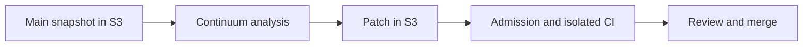

I connected [AWS Continuum][continuum] to my [mem9 deployment][mem9-post] to see whether an AI security service could move beyond reporting vulnerabilities and help deliver verified fixes. It did produce useful remediation work. It also exposed two costs I had underestimated: the engineering needed to admit generated patches safely, and the inference cost of a full repository scan.

The experiment covered a codebase of roughly 233,000 lines across 704 files. My investigation put **one full scan at roughly $250–370 in inference charges**, based on approximate scan-window attribution. That is an observation from this workload, not a fixed price per scan or a quote for another repository.

This post covers **Continuum for code vulnerabilities**, the S3 integration I used, what happened to the patches, and what I would change before enabling it again. Product behavior and published pricing were checked on November 17, 2026. I subsequently retired this mem9 deployment after [moving shared agent memory to Markdown and Git][memory-replacement]; the examples here describe that historical deployment.

## What I tested

The [public mem9-on-aws repository][mem9-repo] included a memory API, an embedding service, authentication and gateway code, infrastructure definitions, and deployment tooling. That gave the scanner several kinds of security-sensitive code to examine.

AWS describes Continuum for code vulnerabilities as a service that discovers findings, validates exploitability, prioritizes issues, and generates remediation patches. Its [API overview][api-overview] distinguishes an **integration**, which connects a source provider, from an **environment**, which selects sources and governs the analysis. Findings, issues, and scans are separate objects.

I tested source scanning and patch delivery. I did not run a comparative accuracy benchmark or evaluate Continuum's penetration-testing capability. I therefore cannot give a false-positive rate, a vulnerability-detection percentage, or an estimate of security-review hours saved.

The useful evidence is narrower: the integration ran, generated patches reached review, some changes landed, and some required substantial repair.

## Why the workflow went through S3

The first integration problem was repository eligibility. During the November 11 setup, the direct GitHub path rejected the public repository. I added a [visibility check before environment creation][visibility-fix], then used the documented [Amazon S3 integration][getting-started]. That is the behavior encountered in this experiment; check current source-provider requirements before planning a new integration.

The S3 route also made the source revision explicit. A trusted workflow on `main` archived one committed revision into a private bucket. Continuum read that snapshot and [delivered patches][patch-docs] under the bucket's `continuum-patches/` prefix. My controller then verified their origin and opened GitHub pull requests.



The basic archive step was ordinary Git:

```bash
# Run from a clean checkout of the main revision selected for scanning.
source_sha=$(git rev-parse HEAD)
git archive --format=zip --output="/tmp/source-${source_sha}.zip" "$source_sha"
```

`git archive` selects committed content, which excludes untracked local files. It does not make committed secrets safe: the selected source still needs a secret scan. The controller used a separate, immutable object key for each source revision and recorded the relationship between commit, scan, artifact, and PR. The [integration design][s3-design] documents the full workflow. Design and acceptance-test links in this post are pinned to the November 12 repair commit.

This was more work than connecting a repository and waiting for a PR. I owned snapshot publication, patch retrieval, source attribution, GitHub admission, and recovery when the service and repository advanced at different speeds.

## A successful scan is only one milestone

The first important controller correction concerned asynchronous processing. A scan could finish while Continuum was still processing issues or delivering their patches. Rotating the environment's source immediately could leave later patches unable to resolve the integration associated with their source. The [fix retained the source through remediation and delivery][source-retention-fix].

The current [scan documentation][scan-docs] explicitly says that issue processing and patch generation can continue after a scan succeeds.

I had to track four distinct results:

| Milestone | What it established in this workflow |
|---|---|
| Scan succeeded | Source analysis reached its successful terminal state |
| Patch delivered | The generated artifact reached the configured destination |
| Patch admitted | The controller verified its source, bytes, paths, and PR identity |
| Fix accepted | Required tests and review passed; the repair PR also recorded preview end-to-end acceptance |

The controller kept the source stable while known issues or deliveries remained active. It also treated unknown states and incomplete delivery counts conservatively. An aggregate failure did not prove every delivery had finished: the [patch-delivery model][delivery-model] gives `FAILED` priority over `PENDING`, so one failed patch could coexist with another still being delivered.

## What the patches actually improved

There were useful, concrete outcomes. One [generated patch that merged][tls-patch] strengthened the database bootstrap connection by moving from TLS encryption alone to certificate and hostname verification using the image's CA bundle.

Other remediation work needed a separate [repair PR][repair-pr]. That distinction matters: the merged implementation was not simply the scanner's original output with an approval attached.

| Area | What the accepted implementation needed |
|---|---|
| Bootstrap database connection | Verify the server certificate and hostname against the expected CA bundle |
| Embedding and gateway logs | Use fixed events and bounded metadata; avoid logging request content, headers, and raw exception details |
| Embedding cancellation | Stop native inference work before admitting replacement work |
| Private evidence reads | Reject special files and path substitution, and bound reads even if a file grows |

The cancellation case was particularly instructive. Returning an HTTP timeout does not necessarily stop the native inference consuming CPU and memory. The repaired implementation put inference in a supervised process. On an active request's deadline or disconnection, the supervisor terminated that process and waited for it to exit before releasing capacity and loading a replacement. The [repair PR][repair-pr] records the implementation and its verification.

The file-reading case had a similar gap between plausible code and actual behavior. A size check around a normal file did not address a FIFO that could block on open, an ancestor directory replaced during traversal, or a file growing while read. The repair added bounded, descriptor-based reads and tests using real filesystem objects.

Those examples are why I found the experiment worthwhile as security work. They are also why I would not treat a generated remediation as production-ready. Review found problems in proposed fixes, and reproducing the relevant runtime behavior changed the implementation. The repair PR records tests with a real ONNX model in an isolated container, followed by preview end-to-end acceptance.

## Reviewing generated patches

In my [patch workflow][s3-design], I checked that each patch matched the source version and tested it without AWS credentials or repository write access. Changes to infrastructure, dependencies, pipeline code, or tests also needed owner approval before merging. These checks added engineering effort beyond running the scan: generating a patch was only the start of getting a fix accepted.

## The cost of one full scan

For this repository, I estimated **roughly $250–370 in inference charges for a full-scan window**. Attribution is approximate because issue processing and patch generation can continue after the scan succeeds. The range excludes the separate context fee and supporting infrastructure; it is not an all-inclusive price for an accepted fix.

The [published pricing][pricing] separates a monthly context fee from usage-based inference. As checked on November 17, 2026, inference costs **$10 per Continuum inference unit**, or CIU. AWS does not present that unit as a fixed price per scan. Its examples make assumptions about work per vulnerability, and actual inference varies with the work required.

The practical question for a pilot is how much inference one scan of the intended source consumes, and whether its findings justify that cost. Repository line count alone is not enough to predict it.

The same pricing page limits its free trial to penetration testing. I would not assume that trial covers code-vulnerability scanning.

### Manual service scheduling did not make my controller manual

My [controller][s3-design] ran on main-branch updates and periodic reconciliation. It coalesced changes while work was active, but it also requested daily rescans when `main` had not changed. A controller invocation was not automatically a new scan; nevertheless, its scheduling policy kept producing additional scans.

That was my automation policy. The service also defaults to daily recurring scans, but setting its schedule to manual did not prevent my own controller from calling the scan API.

At this approximate per-scan cost, I would not enable daily rescans of unchanged code by default for a pilot. I would also not budget an S3 upload as an inexpensive incremental scan without measuring that behavior on the intended workload.

There is an earlier billing trigger to consider. AWS documents that **creating an environment starts its first scan even when “Manual only” is selected**. The same [documentation][scan-docs] says a queued scan cannot be canceled. Select the source and budget before creating the environment, rather than treating creation as a cost-free configuration step.

For a future pilot, I would start with one measured scan, inspect the findings and bill, then choose a cadence. Follow-up patch validation would reconcile the existing artifact rather than start another repository scan; my controller already had a [patch-selection mode][s3-design] for that purpose. Unchanged code may still justify a later security rescan, but it should be a deliberate decision with a budget.

## What I would keep, and what I would change

AWS Continuum led to useful code changes in this experiment. The [merged TLS patch][tls-patch] was a concrete improvement. The [repair PR][repair-pr] showed the other side of the experience: generated remediations could require substantial changes before they were ready to accept. Both outcomes matter when evaluating what the service contributes.

I would keep source traceability, isolated tests, and checks of the behavior each fix is meant to change. I would consider another pilot where I could reproduce the relevant behavior and set aside time to review and repair the output. That makes it a plausible option for a planned security review alongside the application's existing tests and code review.

My next run would start with one selected source revision and one scan, after setting a budget for the pilot. I would review the existing artifacts before authorizing another scan and leave daily rescans of unchanged code disabled. Any later scan would have a specific reason and an allowance for its cost.

I would record the distinct fixes accepted, the work needed to verify or rewrite them, and the approximate inference cost associated with the scan. I would keep using it only if the accepted fixes justified both the service spend and that engineering effort.

## Resources

- [AWS Continuum pricing][pricing]
- [Code-vulnerability setup and S3 integration][getting-started]
- [Scan scheduling and lifecycle][scan-docs]
- [Patch delivery documentation][patch-docs]
- [The mem9 S3 integration design][s3-design] and [acceptance cases][acceptance-cases]
- [Merged database TLS patch][tls-patch] and [follow-up remediation repair][repair-pr]
- [My original mem9 deployment][mem9-post] and [the memory workflow that replaced it][memory-replacement]

---

<!-- Official AWS Documentation -->
[continuum]: https://aws.amazon.com/continuum/
[pricing]: https://aws.amazon.com/continuum/pricing/
[api-overview]: https://docs.aws.amazon.com/continuum/latest/APIReference/Welcome.html
[getting-started]: https://docs.aws.amazon.com/continuum/latest/userguide/cv-getting-started.html
[scan-docs]: https://docs.aws.amazon.com/continuum/latest/userguide/cv-triggering-scan.html
[patch-docs]: https://docs.aws.amazon.com/continuum/latest/userguide/cv-viewing-patches.html
[delivery-model]: https://docs.aws.amazon.com/aws-sdk-php/v3/api/api-continuum-2022-07-26.html#shape-issuepatchdelivery

<!-- Public Source and Review Evidence -->
[mem9-repo]: https://github.com/zxkane/mem9-on-aws
[s3-design]: https://github.com/zxkane/mem9-on-aws/blob/94375a25807577d1f30bac05065a3207107182bc/docs/designs/continuum-s3.md
[acceptance-cases]: https://github.com/zxkane/mem9-on-aws/blob/94375a25807577d1f30bac05065a3207107182bc/docs/test-cases/continuum-s3.md
[visibility-fix]: https://github.com/zxkane/mem9-on-aws/pull/326
[source-retention-fix]: https://github.com/zxkane/mem9-on-aws/pull/328
[tls-patch]: https://github.com/zxkane/mem9-on-aws/pull/336
[repair-pr]: https://github.com/zxkane/mem9-on-aws/pull/337

<!-- Related Articles -->
[mem9-post]: 
[memory-replacement]: 
